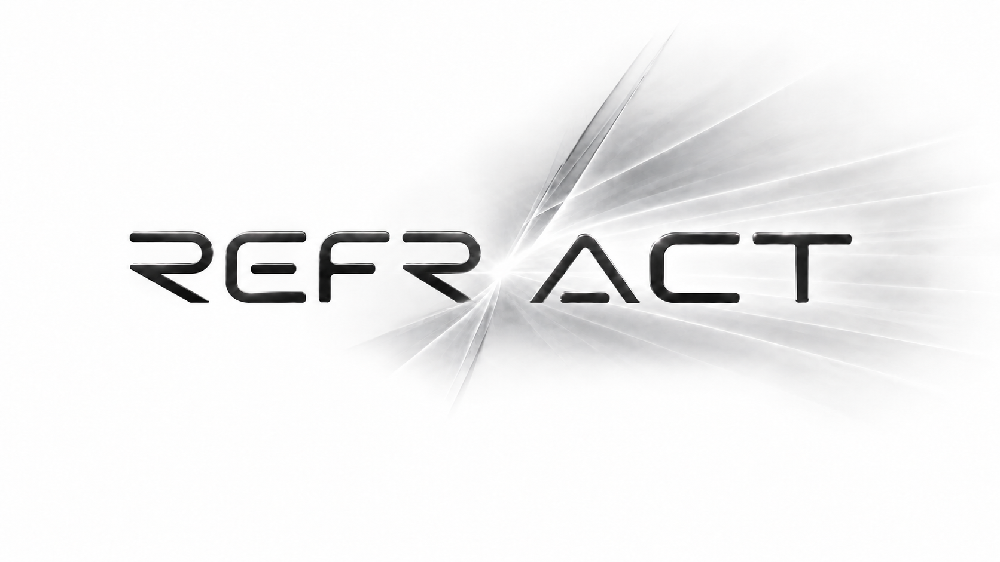

  

<h1 align="center">如果我们不曾相遇</h1>

<strong>REFR/ACT 2027 · 启程预告</strong> 
Into a Different Medium.

## 在创造之前，我们首先是人。

我们习惯问一个人擅长什么、做过什么。我们更想坐下来，听听他为什么想做这件事。

一个从没碰过硬件的人坐在机械工程师旁边。一个设计师的问题让程序员重新想了一遍自己的代码。他们原本可能不会认识。没有人知道相遇之后会做出什么，而这正是我们想看看会发生的事。

**有些事，只有相遇才会发生。** [读中文启程预告](https://github.com/REFR-ACT/Hackathon-Playbook/blob/main/docs/zh/into-a-different-medium.md)

**2027 年春季 · 美国新泽西州普林斯顿地区 · 线下黑客松 · 预计 500 名创造者。** 具体日期及场地待公布。DAY 5 上午是全员作品展，每支提交作品的队伍都有自己的展位。

**主办方：**识构智能科技（上海）有限公司

**执行团队：**REFR/ACT 团队

| 入口 | 去哪里 |
| --- | --- |
| **JOIN · 选手报名** | 暂未开放 · [最新排期](https://github.com/REFR-ACT/Hackathon-Playbook/blob/main/docs/zh/schedule.md) |
| **CREW · 幕后共创** | [筹备组报名 · 飞书](https://gcnnm88gjxtf.feishu.cn/share/base/form/shrcnjx100H5sj6CpxdI7o3hZce) · [公开岗位说明 · Google Docs](https://docs.google.com/document/d/1Gu1MRFe0LIX-ntcfnNNG2Q6b_m2b3C5p3239r8Ufv0c/edit) |
| **PARTNER · 商务合作** | [企业与社区合作](https://github.com/REFR-ACT/Hackathon-Playbook/blob/main/docs/zh/partnerships.md) · [contact@refracthack.org](mailto:contact@refracthack.org) |

筹备组招募开发与运维、体验与现场运营、赞助与财务、设计、宣发与叙事。体验与现场运营（EXP）需要能到 Princeton 附近线下参与，其余四组可远程，包括中国国内。

## If Our Worlds Had Never Met

We’re used to asking people what they’ve done and what they’re good at. We don’t often get to sit down and ask why they wanted to make something in the first place.

Put someone who’s never touched hardware next to a mechanical engineer. Let a designer ask the question that makes a programmer look at their code again. We can make room for the encounter. What they make is up to them.

**Some things would never happen if our worlds never met.** [Read the full preview](https://github.com/REFR-ACT/Hackathon-Playbook/blob/main/docs/en/into-a-different-medium.md)

**Spring 2027 · Princeton area, New Jersey · In person · About 500 creators expected.** Exact dates and venue are to be announced. On the morning of Day 5, every team that submits a project will have a booth at the Open Expo.

**Host:** Shigou Intelligent Technology (Shanghai) Co., Ltd.

**Organizing Committee:** The REFR/ACT team

| Entry | Where to go |
| --- | --- |
| **JOIN · Participants** | Registration not open yet · [Event schedule](https://github.com/REFR-ACT/Hackathon-Playbook/blob/main/docs/en/schedule.md) |
| **CREW · Organizing team** | [Apply on Feishu](https://gcnnm88gjxtf.feishu.cn/share/base/form/shrcnjx100H5sj6CpxdI7o3hZce) · [Role descriptions on Google Docs](https://docs.google.com/document/d/1Gu1MRFe0LIX-ntcfnNNG2Q6b_m2b3C5p3239r8Ufv0c/edit) |
| **PARTNER · Sponsorship and collaboration** | [Partnership guide](https://github.com/REFR-ACT/Hackathon-Playbook/blob/main/docs/en/partnerships.md) · [contact@refracthack.org](mailto:contact@refracthack.org) |

We’re recruiting for Development, Experience & Operations, Sponsorship & Finance, Design, and Communications & Storytelling. Experience & Operations needs people on site near Princeton; the other four teams can contribute remotely, including from China.

---

[官网 / Website](https://refracthack.org/) · [中文 Playbook](https://github.com/REFR-ACT/Hackathon-Playbook/blob/main/README.zh.md) · [English Playbook](https://github.com/REFR-ACT/Hackathon-Playbook) · [PRISMS House Event](https://refracthack.org/housegame/)（独立校内学院游戏赛 / a separate school game competition）
